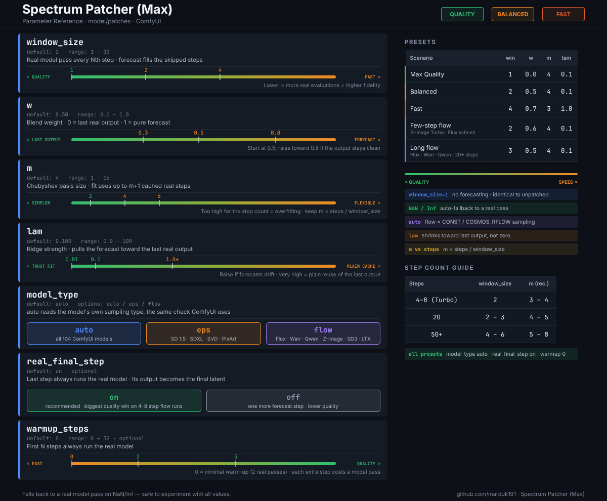

# Spectrum Patcher — ComfyUI Model Patch


Training-free diffusion acceleration via Chebyshev spectral forecasting (in the style of *Adaptive Spectral Feature Forecasting for Diffusion Sampling Acceleration*). It runs the real model only every few steps and forecasts the steps in between.

- Research code: https://github.com/hanjq17/Spectrum
- Original ComfyUI node: https://github.com/maximilianwicen/ComfyUI-Node-for-Adaptive-Spectral-Feature-Forecasting-for-Diffusion-Sampling-Acceleration. This repository is a fork of it.

This custom node is a **MODEL patcher**: it wraps the model's forward pass via `set_model_unet_function_wrapper(...)`, so it works with all normal ComfyUI samplers (Euler, DPM++, UniPC, res_multistep, ...).

## Install

Clone into `ComfyUI/custom_nodes`, then restart ComfyUI:

```bash
cd /path/to/ComfyUI/custom_nodes
git clone https://github.com/marduk191/ComfyUI-Node-for-Adaptive-Spectral-Feature-Forecasting-for-Diffusion-Sampling-Acceleration.git ComfyUI-Max-Spectrum
```

No extra Python packages are needed beyond what ComfyUI already installs.

## Quick start

1. Put **Spectrum Patcher (Max)** on the MODEL line, after the loader and any LoRAs and before the sampler:

   `Load Diffusion Model → (LoRAs) → Spectrum Patcher (Max) → KSampler`

2. Leave `model_type` on `auto`. It recognizes every model ComfyUI supports.
3. Start from the **Balanced** preset below. Lower `window_size` if quality drops; raise it for more speed.

A shift node (`ModelSamplingSD3`, `ModelSamplingFlux`, `ModelSamplingAuraFlow`, ...) can sit on either side of the patcher. The patcher reads the model's sampling settings when sampling starts.

| Node info | |
|---|---|
| Menu name | **Spectrum Patcher (Max)** |
| Category | `model/patches` |
| Internal id | `MaxSpectrumPatcher` |

## Parameters

| Input | Default | Range | What it does |
|---|---|---|---|
| `w` | `0.5` | 0.0 – 1.0 | Blend on forecast steps: `0` reuses the last real output, `1` uses the pure forecast |
| `m` | `4` | 1 – 16 | Chebyshev basis size. The fit uses up to `m+1` cached real outputs. Keep `m` below `steps / window_size`. |
| `lam` | `0.1` | 0 – 100 | Ridge strength. Higher values pull the forecast toward the last real output (plain caching); `0` trusts the polynomial fully. |
| `window_size` | `2` | 1 – 32 | Run the real model every Nth step and forecast the rest. `1` disables forecasting. |
| `model_type` | `auto` | auto / eps / flow | `auto` reads the model's sampling type the same way ComfyUI does. `flow` and `eps` force a mode. |
| `real_final_step` | on | optional | Always run the real model on the schedule's last step. That step's output becomes the final latent, so forecasting it costs the most quality, especially on short flow schedules. |
| `warmup_steps` | `0` | 0 – 32, optional | Always run the real model for the first N steps, where the output changes fastest. `0` keeps the minimal warm-up: the two real passes the fit needs. Each extra step costs a model pass, so keep it at `0–2` on 4–8 step schedules. |

Every node input has a tooltip with the same information.

### Presets

| Scenario | `window_size` | `w` | `m` | `lam` |
|---|---|---|---|---|
| Max quality (no forecasting) | 1 | 0.0 | 4 | 0.1 |
| Balanced | 2 | 0.5 | 4 | 0.1 |
| Fast | 4 | 0.7 | 3 | 1.0 |
| Few-step flow (Z-Image Turbo, Flux schnell, lightning LoRAs; 4–8 steps) | 2 | 0.6 | 4 | 0.1 |
| Long flow (Flux, Wan, Qwen-Image, HunyuanVideo; 20+ steps) | 3 | 0.5 | 4 | 0.1 |

All presets use `model_type` `auto`, `real_final_step` on and `warmup_steps` `0`.

| Steps | `window_size` | `m` |
|---|---|---|
| 4–8 (turbo / distilled) | 2 | 3 – 4 |
| 20 | 2 – 3 | 4 – 5 |
| 50+ | 4 – 6 | 5 – 8 |

How many passes you save depends on the schedule. With `window_size` 2, an 8-step run makes 6 real passes, and longer runs approach one real pass in two. Steps 0 and 1 (warm-up), every `window_size`-th step, and the final step always run for real.

## Compatible models

Every generative model ComfyUI registers works with the patcher, 104 in total: 74 flow and 30 non-flow. The lists below come straight from ComfyUI's `comfy/supported_models.py` at [Comfy-Org/ComfyUI@`0dbfd49`](https://github.com/Comfy-Org/ComfyUI/tree/0dbfd493b4cc604db743c699f0f7ce01348e54a4) (2026-10-31). Every entry is covered by `tests/test_flow_models.py`.

`model_type = auto` decides "flow" the same way ComfyUI does (`isinstance(model_sampling, comfy.model_sampling.CONST)`, plus `COSMOS_RFLOW`). Models ComfyUI adds later are detected without changes to this node, as long as they use ComfyUI's standard flow sampling, as every current flow model does.

### Flow models

| Family | ComfyUI model configs | Sampling |
|---|---|---|
| Flux.1 (dev / schnell / fill) | `Flux`, `FluxSchnell`, `FluxInpaint` | `ModelSamplingFlux` |
| Flux.2, Flux 3 | `Flux2`, `Flux3` | `ModelSamplingFlux` |
| Chroma, Chroma Radiance | `Chroma`, `ChromaRadiance` | `ModelSamplingFlux` |
| Qwen-Image | `QwenImage`, `QwenImage21` | `ModelSamplingFlux` |
| LongCat-Image, Krea 2, FIBO 2, Microsoft Lens | `LongCatImage`, `Krea2`, `Fibo2`, `Lens` | `ModelSamplingFlux` |
| LTX-Video, LTX audio+video | `LTXV`, `LTXAV` | `ModelSamplingFlux` |
| SD3 / SD3.5, AuraFlow | `SD3`, `AuraFlow` | `ModelSamplingDiscreteFlow` |
| Z-Image (Turbo), Z-Image pixel-space, Ming-Image, Lumina 2 | `ZImage`, `ZImagePixelSpace`, `MingImage`, `Lumina2` | `ModelSamplingDiscreteFlow` |
| HiDream, HiDream-O1 | `HiDream`, `HiDreamO1` | `ModelSamplingDiscreteFlow` |
| HunyuanImage 2.1 (+ refiner) | `HunyuanImage21`, `HunyuanImage21Refiner` | `ModelSamplingDiscreteFlow` |
| OmniGen2, Boogu | `Omnigen2`, `Boogu` | `ModelSamplingDiscreteFlow` |
| Kandinsky 5 (image / video) | `Kandinsky5Image`, `Kandinsky5` | `ModelSamplingDiscreteFlow` |
| MOSS-Image and other image DiTs | `MOSSImage`, `MageFlow`, `JoyImage`, `Ideogram4`, `Anima`, `ErnieImage`, `PiD`, `PixelDiTT2I`, `SenseNovaU15` | `ModelSamplingDiscreteFlow` |
| Wan 2.1 | `WAN21_T2V`, `WAN21_I2V`, `WAN21_FunControl2V`, `WAN21_Vace`, `WAN21_Camera`, `WAN21_HuMo`, `WAN21_SCAIL`, `WAN21_SCAIL2`, `WAN21_CausalAR_T2V` | `ModelSamplingDiscreteFlow` |
| Wan 2.2 and later | `WAN22_T2V`, `WAN22_S2V`, `WAN22_Camera`, `WAN22_Animate`, `WAN22_WanDancer`, `WAN_Animate2` | `ModelSamplingDiscreteFlow` |
| Wan 2.1 FlowRVS | `WAN21_FlowRVS` | `ModelSamplingDiscrete` + `IMG_TO_IMG_FLOW` |
| HunyuanVideo (T2V / I2V / SkyReels), HunyuanVideo 1.5 (+ SR) | `HunyuanVideo`, `HunyuanVideoI2V`, `HunyuanVideoSkyreelsI2V`, `HunyuanVideo15`, `HunyuanVideo15_SR_Distilled` | `ModelSamplingDiscreteFlow` |
| Mochi, SeedVR2 | `GenmoMochi`, `SeedVR2` | `ModelSamplingDiscreteFlow` |
| MiniMax H3 (audio+video) | `MiniMaxH3` | `ModelSamplingAV` |
| Cosmos Predict2 (T2I / I2V) | `CosmosT2IPredict2`, `CosmosI2VPredict2` | `ModelSamplingCosmosRFlow` |
| Audio: Stable Audio 3, ACE-Step (1.0 / 1.5), MiniMax Music 3, YuE 2 | `StableAudio3`, `ACEStep`, `ACEStep15`, `MiniMaxMusic3`, `YuE2` | `ModelSamplingDiscreteFlow` |
| 3D: Hunyuan3D 2.0 / 2.0 mini / 2.1, TripoSplat, Trellis 2 | `Hunyuan3Dv2`, `Hunyuan3Dv2mini`, `Hunyuan3Dv2_1`, `TripoSplat`, `Trellis2` | `ModelSamplingDiscreteFlow` |

### Non-flow models

`auto` picks `eps` for all 30 non-flow models ComfyUI registers:

- SD 1.x/2.x and variants: `SD15`, `SD15_instructpix2pix`, `SD20`, `SD21UnclipL`, `SD21UnclipH`, `Stable_Zero123`, `LotusD`, `SD_X4Upscaler`
- SDXL and variants: `SDXL`, `SDXLRefiner`, `SDXL_instructpix2pix`, `SSD1B`, `KOALA_700M`, `KOALA_1B`, `Segmind_Vega`
- DiTs: `PixArtAlpha`, `PixArtSigma`, `HunyuanDiT`, `HunyuanDiT1`
- Stable Cascade: `Stable_Cascade_C`, `Stable_Cascade_B`
- Video and 3D: `CosmosT2V`, `CosmosI2V` (Cosmos 1.0, EDM), `CogVideoX_T2V`, `CogVideoX_I2V`, `CogVideoX_Inpaint`, `SVD_img2vid`, `SV3D_u`, `SV3D_p`
- Audio: `StableAudio` (1.0)

### Test results

These come from the test harness, which uses a stand-in network. Read them as relative comparisons, not as image quality.

- All 74 flow models, at both `cfg=1` and `cfg=4`: model passes drop to 75% at 8 steps with `window_size=2`, and the result stays within 2.5% of the unpatched run.
- Across 120 sampler×scheduler combinations, the forecast is at least as accurate as plain "reuse the last output" caching in 115. The samplers are euler, dpmpp_2m, heun, res_multistep and uni_pc_bh2; the schedulers are simple, beta, normal and sgm_uniform.
- The exceptions are listed under [Known limitations](#known-limitations).

### Flow model tips

- **Few-step / distilled models** (Z-Image Turbo, Flux schnell, Wan or Qwen lightning LoRAs; 4–8 steps): use the few-step flow preset and keep `real_final_step` on.
- **Longer schedules** (20–50 steps on Flux, Wan, HunyuanVideo, Qwen-Image): `window_size` `3–4` saves more passes.
- **Wan 2.2 two-expert (high/low noise) workflows:** put one patcher on each model. Each expert's first two steps (warm-up) and its final step run for real. A stage of only ~4 steps therefore has little or nothing left to forecast. The patcher pays off from ~8 steps per stage, or with `window_size` `3`.
- **Samplers and schedulers:** any flow-compatible combination works (euler, dpmpp_2m, res_multistep, uni_pc, ...). All of the ones listed above are covered by the tests.

## Using it with other nodes

- **Shift / sampling nodes** (`ModelSamplingSD3`, `ModelSamplingFlux`, `ModelSamplingAuraFlow`, ...): these work on either side of the patcher.
- **Other nodes that use the model-function hook:** ComfyUI has a single `model_function_wrapper` slot, used for example by ComfyUI's `ChromaRadianceOptions`.
  - A node placed **before** the patcher keeps working: the patcher calls it on every real pass.
  - A node placed **after** the patcher must chain the existing wrapper itself, or it replaces the patcher. `ChromaRadianceOptions` does chain when `preserve_wrapper` is on, its default.
  - Forecast steps skip the model entirely, so the earlier wrapper doesn't run on those steps.
- **LoRAs and model merges:** these change weights, not the forward hook, so they combine with the patcher in either order.

## Known limitations

- **Very wide sigma ranges:** SVD and SV3D (sigma up to 700) and Stable Audio 1.0 (up to 500) run correctly, but expect little benefit. Over such ranges, skipping steps is lossy even with plain reuse of the last output, and the forecast is roughly on par with that, especially at low step counts.
- **Cosmos Predict2:** sigmas span 0.002–80, and the forecast comes out about even with plain caching. It works, but the gain is smaller than on other flow models.
- **Test coverage:** the tests run every model's real sampling code with a stand-in network. They prove compatibility and compare accuracy between versions, but they are not a measure of image quality on real weights.

## How it works

1. The patcher hooks `BaseModel.apply_model`, whose output is the **denoised (x0) prediction** for every model type. For flow models that is `x − σ·velocity`.
2. It reads the sampling schedule from `transformer_options["sample_sigmas"]` to know which step it is on.
3. **Real passes** run on warm-up steps, every `window_size`-th step and the final step. Their outputs are cached, keeping up to `m+1` of the most recent ones.
4. **Fitting:** after each real pass, the cached outputs are fitted against sigma with a Chebyshev basis of size `m`, using ridge regression (`lam`).
   - The fit is made relative to the newest real output, so regularization pulls the forecast toward that output rather than toward zero.
   - Separate state is kept for cond and uncond batches.
5. **Forecast steps** evaluate the fit at the current sigma and blend it with the last real output using `w`.
6. **Safeguards:**
   - State resets when a new sampling run starts, or when the latent's shape, dtype or device changes.
   - If the fit fails or produces NaN/Inf, the patcher runs the real model instead.

## Testing

`tests/test_flow_models.py` runs this node through ComfyUI's real sampler, with no model weights needed:

- **Setup:**
  - Every registered ComfyUI model is built with its own `model_base` class, `model_sampling` and latent format, and the diffusion network is swapped for a tiny deterministic stand-in.
  - When a model's real class needs inputs the harness doesn't fake, the harness falls back to a plain `BaseModel` carrying that model's real `model_sampling`.
- **Per-model checks:** flow detection matches ComfyUI, fewer model passes are made, and how far the result drifts from the unpatched run.
- **Sampler×scheduler matrix:** the forecast is compared with plain last-output caching.
- **Edge cases:** low-denoise img2img, shift nodes placed after the patcher, batches, Wan 2.2 two-stage sampling, `warmup_steps`, `ChromaRadianceOptions` chaining, and repeated runs.

```bash
python tests/test_flow_models.py --comfyui /path/to/ComfyUI
```

Add `--quick` to skip the sampler×scheduler matrix, or `-v` to print every check. Known limitations are reported as `XFAIL`; the exit code is non-zero only on real failures. Rerun it after updating ComfyUI to check newly added models.

The parameter chart at the top is generated by `tools/guide-chart/`; see the docstring in `make_chart.py` for how to regenerate it.

## Changelog

### Flow-model update (fork of the original node)

- **Flow detection** now reads the model's own sampling type, the way ComfyUI does. It covers all 104 ComfyUI models; the old sigma-range guess misclassified Cosmos Predict2, Wan 2.1 FlowRVS and low-denoise SDXL img2img.
- **Schedule lookup:** `transformer_options["sigmas"]` is no longer mistaken for the sampling schedule. ComfyUI uses that key for the current step's sigma.
- **Fit:** the forecast is fitted relative to the last real output. Before, regularization pulled every forecast toward zero, and the forecast was less accurate than simply reusing the last output.
- **New optional inputs:**
  - `real_final_step` (default on).
  - `warmup_steps` (default 0), merged from `feat/warmup-steps` (Adam Nizol).
- **Chaining:** the patcher now chains a model-function wrapper set by an earlier node. Before, it silently replaced it; for example, `ChromaRadianceOptions` placed before the patcher was dropped.
- **Docs:** tooltips on every input, a node description, a regenerated parameter chart, and this README.
- **Tests:** an end-to-end test harness covering every ComfyUI model.
